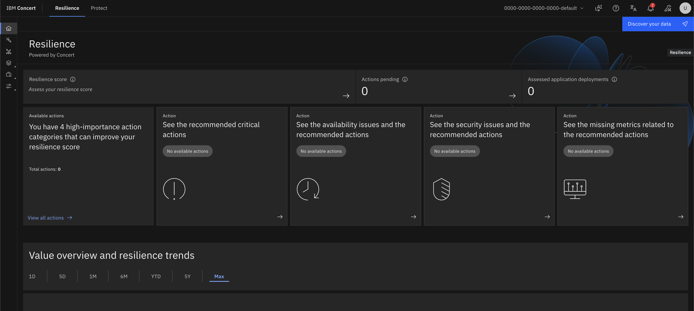
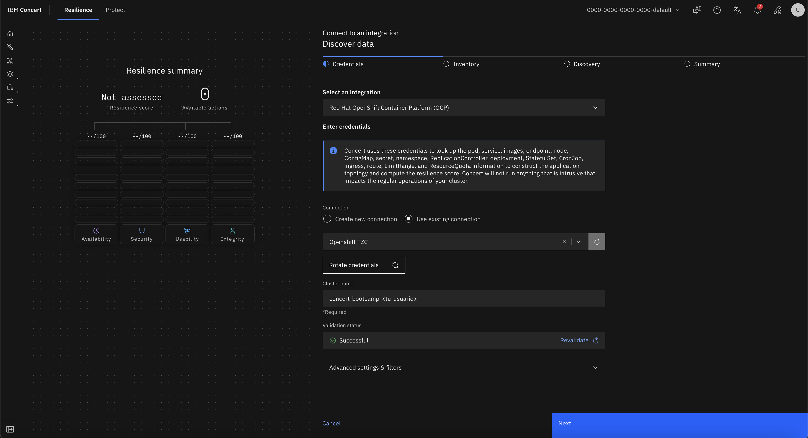
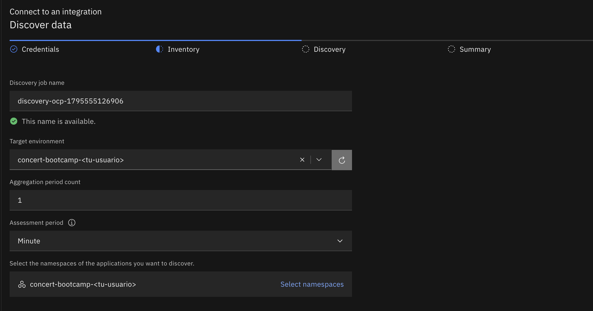
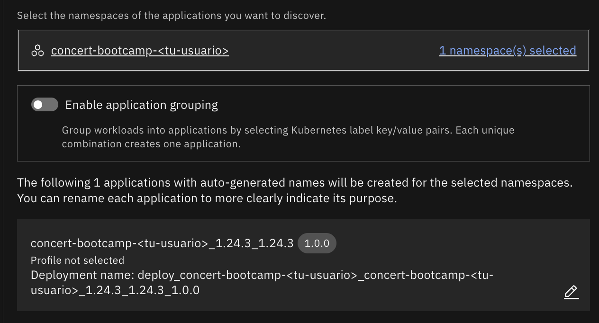
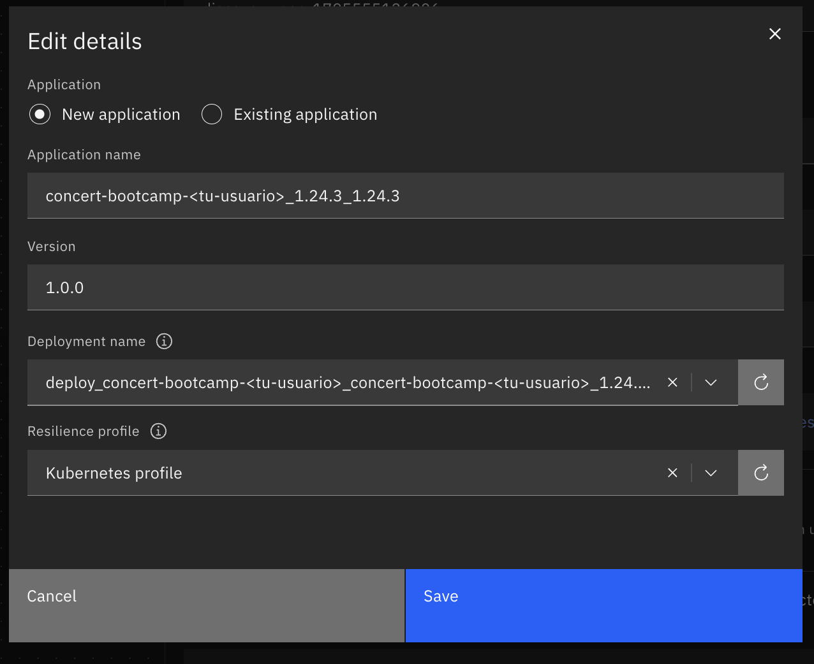

# Instrucciones Mac

[← Volver al inicio](README.md)

## Requisitos
- Acceso a IBM Concert. Tu usuario es `<tu-usuario>` y contraseña `bootcamp`.
- El **token** de OpenShift que te entregaremos.
- **Git**, el CLI de OpenShift (`oc`) y la app **Terminal** (viene con tu Mac: búscala con `⌘ + Espacio` → "Terminal").

### Instalar `oc`

1. Instala Homebrew (si ya lo tienes, salta este paso; puedes comprobarlo con `brew --version`):
```bash
/bin/bash -c "$(curl -fsSL https://raw.githubusercontent.com/Homebrew/install/HEAD/install.sh)"
```
Te va a pedir la contraseña de tu Mac. Al final, si muestra **"Next steps"**, copia y ejecuta los comandos que aparecen ahí (agregan `brew` a tu `PATH`).

2. Instala `oc`:
```bash
brew install openshift-cli
```

### Verificar
```bash
oc version --client
```
Debe mostrar `Client Version: 4.x.x`.

## 0. Prepara la terminal
1. Clona **este repositorio**.
2. Abre **Terminal** dentro de la carpeta `bootcamp-concert`.
3. Pega el comando `oc login` que te enviaremos con un token para que inicies sesión en el cluster.

> No compartas tu token.

## 1. Despliega tu app
En tu terminal, dentro de la carpeta `bootcamp-concert`:

```bash
bash desplegar.sh <tu-usuario>
```

El script crea tu namespace `<tu-usuario>` (si no existe), despliega la app *hola-resiliencia* y espera a que los pods estén listos. Al final muestra la URL de tu app: ábrela para comprobar que funciona.

## 2. Descubre tu app en Concert

Entra a IBM Concert en https://concert-ibm-concert.apps.itz-czzc0l.hub01-lb.techzone.ibm.com/concert/#/ e inicia sesión con tu usuario `<tu-usuario>` y la contraseña `bootcamp`.



1. Concert → **Discover your data** → *Red Hat OpenShift (OCP)* → **Use existing connection**: `Openshift TZC` → Cluster name `<tu-usuario>` → Next.

   

2. Target environment: `<tu-usuario>` · Assessment period: **Minute** · count **1**.

   

3. Namespaces → **Select Namespaces** → *Advanced filters → Include namespaces*: escribe tu namespace `<tu-usuario>` → **Apply**
   → márcalo **solo a él** → **Select**.

   

4. Lápiz de la tarjeta → **New application**, profile **Kubernetes profile** → **Save** → **Next** hasta el Summary.

   

   

## 3. Revisa tu postura inicial
Resilience → **Postures** → tu postura → última evaluación.
Anota **Availability** y **Usability** (deberían estar en 100).

## 4. Quita los health checks
En tu terminal, dentro de la carpeta `bootcamp-concert`:

```bash
bash quitar-probes.sh <tu-usuario>
```

### ¿Qué hace el script?
Por dentro ejecuta este comando:

```bash
oc set probe deployment/hola-resiliencia --readiness --liveness --remove -n <tu-usuario>
```

| Parte | Qué significa |
|---|---|
| `oc set probe` | Modifica los health checks (probes) de un recurso. |
| `deployment/hola-resiliencia` | El Deployment de tu app. |
| `--readiness` | La probe que indica si el pod está **listo para recibir tráfico**. Si falla, Kubernetes deja de enviarle requests. |
| `--liveness` | La probe que indica si el pod **sigue vivo**. Si falla, Kubernetes reinicia el contenedor. |
| `--remove` | Elimina esas probes en vez de crearlas o modificarlas. |
| `-n <tu-usuario>` | El namespace donde está tu app. |

Al cambiar el Deployment, OpenShift crea pods nuevos **sin health checks** y reemplaza los anteriores uno a uno (rolling update), así que la app no se cae. El script espera a que termine (`oc rollout status`) y al final muestra las probes actuales, que deberían salir vacías.

**¿Qué cambia?** La app sigue respondiendo igual, pero Kubernetes ya no puede detectar si se cuelga: le seguiría enviando tráfico y nunca la reiniciaría. Eso es lo que Concert va a detectar en el siguiente paso.

## 5. Reevalúa
Concert → **Integrations → Ingestion jobs** → tu job → **⋮ → Run now**.
Espera **~2 minutos** y abre la **última** evaluación de tu postura.

## 6. Compara
¿Qué pasó con **Availability** y **Usability**?
> Compara esos pilares, no el puntaje total: Security puede variar sola mientras llegan los escaneos.

## 7. (Opcional) Vuelve atrás
```bash
bash restaurar-probes.sh <tu-usuario>
```
Run now otra vez → Availability y Usability deberían volver a 100.

---
**¿Por qué importa?** Sin health checks, Kubernetes solo sabe que el proceso está corriendo.
Si la app se cuelga, le sigue mandando tráfico y nunca la reinicia. Concert lo detecta como
un riesgo de disponibilidad.
