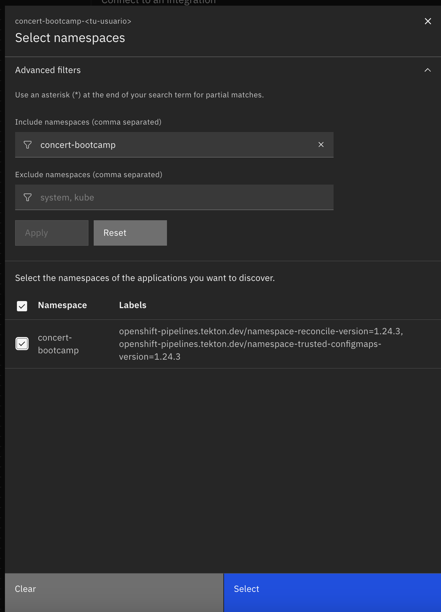

# Instrucciones Mac

[← Volver al inicio](README.md)

## Requisitos
- Acceso a IBM Concert. Tu usuario es `<tu-usuario>` y contraseña `bootcamp`.
- El **token** de OpenShift que te entregaremos (da acceso solo a tu namespace).
- **Git**, el CLI de OpenShift (`oc`) y la app **Terminal** (viene con tu Mac: búscala con `⌘ + Espacio` → "Terminal").

### Instalar `oc`

1. Instala Homebrew (si ya lo tienes, salta este paso; puedes comprobarlo con `brew --version`):
```bash
/bin/bash -c "$(curl -fsSL https://raw.githubusercontent.com/Homebrew/install/HEAD/install.sh)"
```
Te va a pedir la contraseña de tu Mac. Al final, si muestra **"Next steps"**, copia y ejecuta los comandos que aparecen ahí (agregan `brew` a tu `PATH`).

2. Instala `oc`:
```bash
brew install openshift-cli
```

### Verificar
```bash
oc version --client
```
Debe mostrar `Client Version: 4.x.x`.

## 0. Prepara la terminal
1. Clona **este repositorio**.
2. Abre **Terminal** dentro de la carpeta `bootcamp-concert`.
3. Inicia sesión con el token que te enviaremos:

```bash
oc login --token=<tu-token> --server=https://api.itz-czzc0l.hub01-lb.techzone.ibm.com:6443
```
- Si dice que no tienes acceso a proyectos, no pasa nada: los scripts reciben tu namespace como argumento.

> Tu token solo te da acceso a tu namespace. No lo compartas.

## 1. Descubre tu app en Concert


1. Concert → **Discover your data** → *Red Hat OpenShift (OCP)* → **Use existing connection**: `Openshift TZC` → Cluster name `concert-bootcamp-<tu-usuario>` → Next.

   

2. Target environment: `concert-bootcamp-<tu-usuario>` · Assessment period: **Minute** · count **1**.

   

3. Namespaces → **Select Namespaces** → *Advanced filters → Include namespaces*: escribe tu namespace `concert-bootcamp-<tu-usuario>` → **Apply**
   → márcalo **solo a él** → **Select**.

   

4. Lápiz de la tarjeta → **New application**, profile **Kubernetes profile** → **Save** → **Next** hasta el Summary.

   

   

## 2. Revisa tu postura inicial
Resilience → **Postures** → tu postura → última evaluación.
Anota **Availability** y **Usability** (deberían estar en 100).

## 3. Quita los health checks
En la Terminal, dentro de la carpeta `bootcamp-concert`:
```bash
bash quitar-probes.sh concert-bootcamp-<tu-usuario>
```

## 4. Reevalúa
Concert → **Integrations → Ingestion jobs** → tu job → **⋮ → Run now**.
Espera **~2 minutos** y abre la **última** evaluación de tu postura.

## 5. Compara
¿Qué pasó con **Availability** y **Usability**?
> Compara esos pilares, no el puntaje total: Security puede variar sola mientras llegan los escaneos.

## 6. (Opcional) Vuelve atrás
```bash
bash restaurar-probes.sh concert-bootcamp-<tu-usuario>
```
Run now otra vez → Availability y Usability deberían volver a 100.

---
**¿Por qué importa?** Sin health checks, Kubernetes solo sabe que el proceso está corriendo.
Si la app se cuelga, le sigue mandando tráfico y nunca la reinicia. Concert lo detecta como
un riesgo de disponibilidad.
