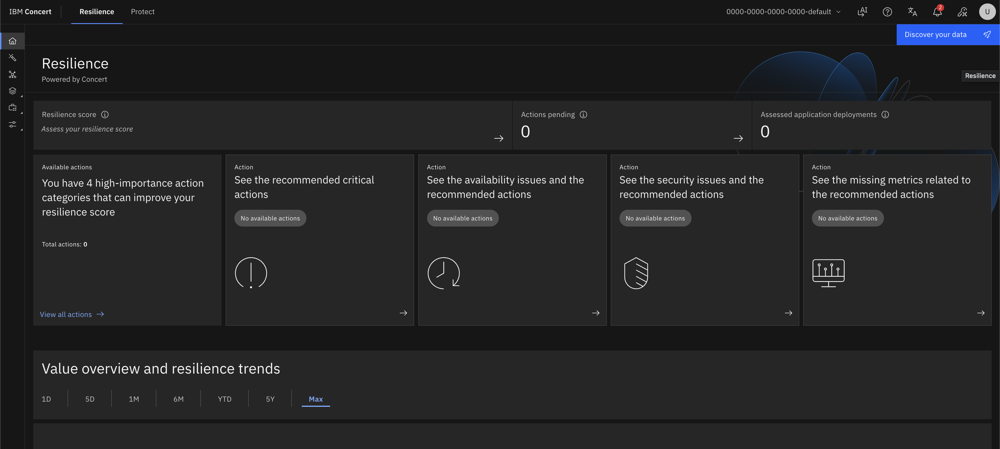
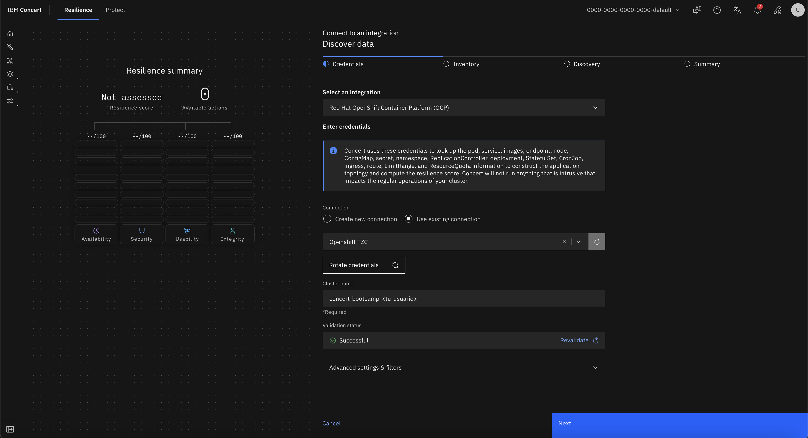
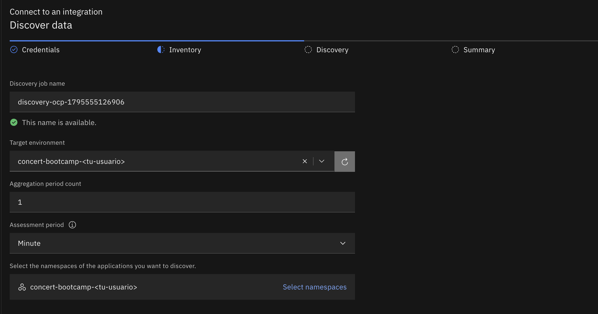
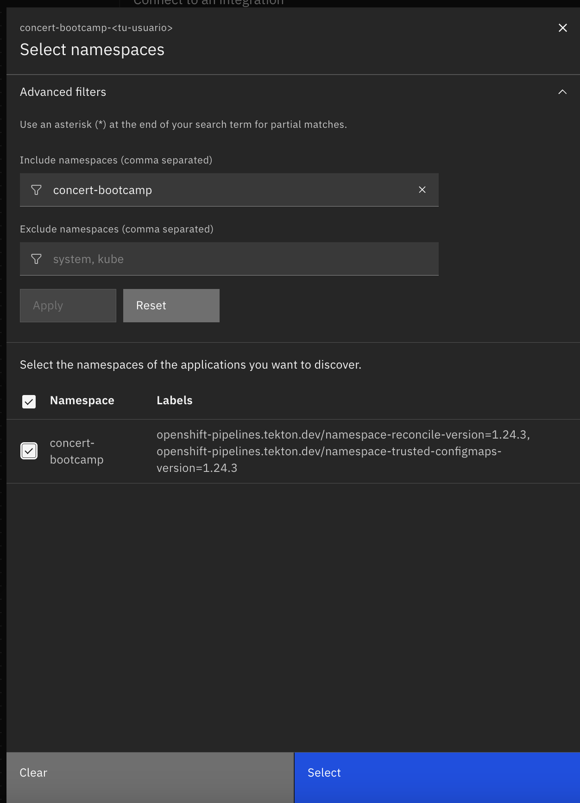
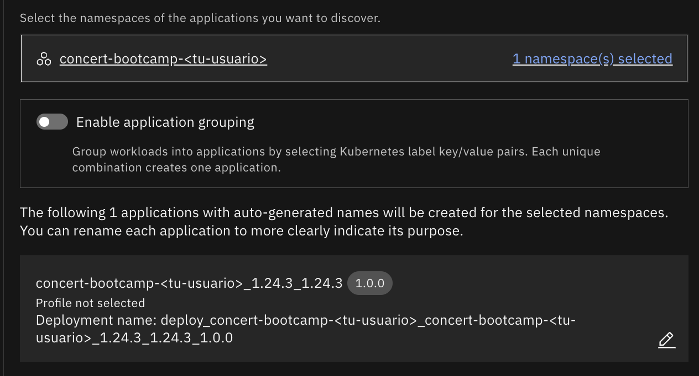
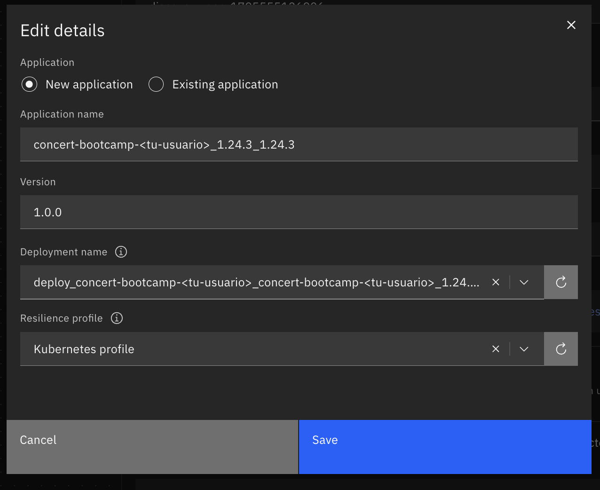

# Instrucciones Windows

[← Volver al inicio](README.md)

## Requisitos
- Acceso a IBM Concert. Tu usuario es `<tu-usuario>` y contraseña `bootcamp`.
- El **token** de OpenShift que te entregaremos (da acceso solo a tu namespace).
- El CLI de OpenShift (`oc.exe`) y **Git Bash** para correr los scripts (son scripts bash; no funcionan en CMD ni PowerShell).

### Instalar Git Bash
Si ya tienes Git instalado, salta este paso (busca "Git Bash" en el menú Inicio).

1. Descarga Git para Windows desde https://git-scm.com/download/win.
2. Instálalo con las opciones por defecto (siguiente, siguiente…).

### Instalar `oc`
1. Descarga https://mirror.openshift.com/pub/openshift-v4/clients/ocp/stable/openshift-client-windows.zip
2. En el Explorador, clic derecho sobre el zip → **Extraer todo…**
3. Abre **Git Bash** y crea la carpeta `bin` en tu usuario (Git Bash la agrega al `PATH` automáticamente):
```bash
mkdir -p ~/bin
explorer.exe "$(cygpath -w ~/bin)"
```
4. Se abre la carpeta `C:\Users\<tu-usuario-de-windows>\bin`. Copia ahí el archivo **`oc.exe`** que extrajiste.
5. Cierra Git Bash y ábrelo de nuevo.

También puedes descargar `oc` desde la consola del cluster: **? → Command line tools**.

### Verificar
En Git Bash:
```bash
oc version --client
```
Debe mostrar `Client Version: 4.x.x`.

## 0. Prepara la terminal
1. Clona **este repositorio**.
2. Abre **Git Bash** dentro de la carpeta `bootcamp-concert`
   (en el Explorador: clic derecho en un espacio vacío → **Open Git Bash here**;
   en Windows 11 puede estar dentro de **Mostrar más opciones**).
3. Pega el comando `oc login` que te enviaremos con un token para que inicies sesión en el namespace con el que interactuarás.

> Tu token solo te da acceso a tu namespace. No lo compartas.

## 1. Descubre tu app en Concert

Entra a IBM Concert en https://concert-ibm-concert.apps.itz-czzc0l.hub01-lb.techzone.ibm.com/concert/#/ e inicia sesión con tu usuario `<tu-usuario>` y la contraseña `bootcamp`.



1. Concert → **Discover your data** → *Red Hat OpenShift (OCP)* → **Use existing connection**: `Openshift TZC` → Cluster name `concert-bootcamp-<tu-usuario>` → Next.

   

2. Target environment: `concert-bootcamp-<tu-usuario>` · Assessment period: **Minute** · count **1**.

   

3. Namespaces → **Select Namespaces** → *Advanced filters → Include namespaces*: escribe tu namespace `concert-bootcamp-<tu-usuario>` → **Apply**
   → márcalo **solo a él** → **Select**.

   

4. Lápiz de la tarjeta → **New application**, profile **Kubernetes profile** → **Save** → **Next** hasta el Summary.

   

   

## 2. Revisa tu postura inicial
Resilience → **Postures** → tu postura → última evaluación.
Anota **Availability** y **Usability** (deberían estar en 100).

## 3. Quita los health checks
En tu terminal, dentro de la carpeta `bootcamp-concert`:

```bash
bash quitar-probes.sh concert-bootcamp-<tu-usuario>
```

### ¿Qué hace el script?
Por dentro ejecuta este comando:

```bash
oc set probe deployment/hola-resiliencia --readiness --liveness --remove -n concert-bootcamp-<tu-usuario>
```

| Parte | Qué significa |
|---|---|
| `oc set probe` | Modifica los health checks (probes) de un recurso. |
| `deployment/hola-resiliencia` | El Deployment de tu app. |
| `--readiness` | La probe que indica si el pod está **listo para recibir tráfico**. Si falla, Kubernetes deja de enviarle requests. |
| `--liveness` | La probe que indica si el pod **sigue vivo**. Si falla, Kubernetes reinicia el contenedor. |
| `--remove` | Elimina esas probes en vez de crearlas o modificarlas. |
| `-n concert-bootcamp-<tu-usuario>` | El namespace donde está tu app. |

Al cambiar el Deployment, OpenShift crea pods nuevos **sin health checks** y reemplaza los anteriores uno a uno (rolling update), así que la app no se cae. El script espera a que termine (`oc rollout status`) y al final muestra las probes actuales, que deberían salir vacías.

**¿Qué cambia?** La app sigue respondiendo igual, pero Kubernetes ya no puede detectar si se cuelga: le seguiría enviando tráfico y nunca la reiniciaría. Eso es lo que Concert va a detectar en el siguiente paso.

## 4. Reevalúa
Concert → **Integrations → Ingestion jobs** → tu job → **⋮ → Run now**.
Espera **~2 minutos** y abre la **última** evaluación de tu postura.

## 5. Compara
¿Qué pasó con **Availability** y **Usability**?
> Compara esos pilares, no el puntaje total: Security puede variar sola mientras llegan los escaneos.

## 6. (Opcional) Vuelve atrás
```bash
bash restaurar-probes.sh concert-bootcamp-<tu-usuario>
```
Run now otra vez → Availability y Usability deberían volver a 100.

---
**¿Por qué importa?** Sin health checks, Kubernetes solo sabe que el proceso está corriendo.
Si la app se cuelga, le sigue mandando tráfico y nunca la reinicia. Concert lo detecta como
un riesgo de disponibilidad.
