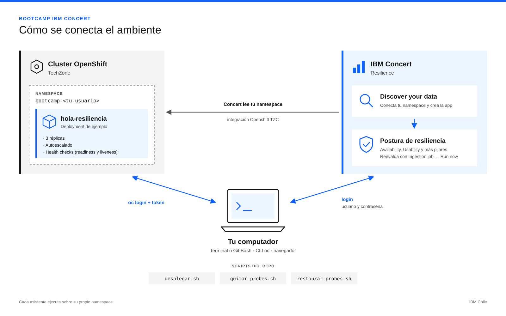

# Bootcamp IBM Concert · BeeTech 

## Caso práctico
Cada asistente trabaja con *hola-resiliencia*, una app sencilla desplegada en su propio namespace de OpenShift. La descubrimos en IBM Concert para obtener su postura, le quitamos los health checks y volvemos a evaluarla para ver cómo Concert detecta el riesgo de disponibilidad que Kubernetes ya no puede ver.

| | Etapa | Qué hacemos |
|---|---|---|
| **01** | **Descubrir la app** | Con *Discover your data* conectamos nuestro namespace y creamos la aplicación en Concert. |
| **02** | **Medir la línea base** | Revisamos la postura inicial y anotamos **Availability** y **Usability**. |
| **03** | **Quitar los health checks** | Con `quitar-probes.sh` eliminamos las probes readiness y liveness del Deployment. |
| **04** | **Reevaluar y comparar** | Con *Run now* generamos una nueva evaluación y comparamos los pilares. |

## Tu usuario
Tu usuario es **tu correo hasta antes del `@`**, reemplazando los puntos (`.`) por guiones (`-`).

| Correo | Usuario |
|---|---|
| `juan@gmail.com` | `juan` |
| `juan.1@gmail.com` | `juan-1` |

Úsalo en todos los pasos donde dice `<tu-usuario>`:
- Para **entrar a IBM Concert**.
- En tu **namespace**: **`bootcamp-<tu-usuario>`** (ej: `bootcamp-juan-1`).

En tu namespace desplegarás la app *hola-resiliencia*, con 3 réplicas, autoescalado y health checks.

## Instrucciones
Elige las instrucciones según tu sistema operativo:

- 🍎 **[Instrucciones Mac](INSTRUCCIONES-MAC.md)**
- 🪟 **[Instrucciones Windows](INSTRUCCIONES-WINDOWS.md)**
